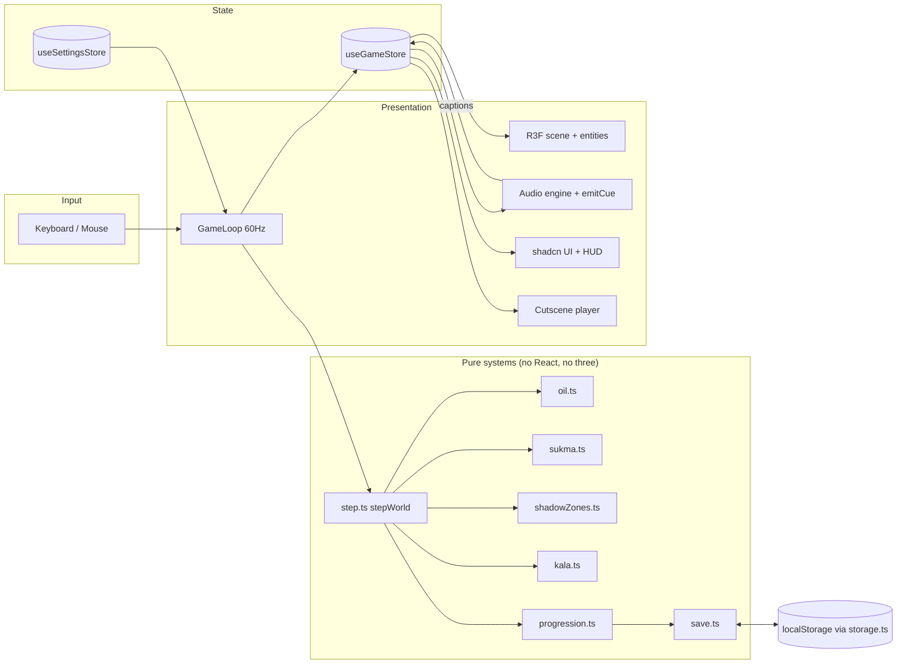

# Design Document

## Overview

KELIR is a Next.js app with a single client-only game route. The game splits into three layers:

1. **Pure logic** (`src/game/systems/`): deterministic TypeScript functions over a 2D floor plan. All rules from the requirements live here and are covered by unit and property-based tests. `stepWorld()` composes them in the tick order below.
2. **State** (`src/stores/`): Zustand stores holding the game state and settings. Only `GameLoop` writes game state (one documented exception: `emitCue()` writes captions); UI and entities read it.
3. **Presentation**: the R3F scene (`src/game/scene`, `src/game/entities`), procedural audio (`src/game/audio`), cutscenes (`src/game/cutscenes`) and the shadcn-based UI (`src/ui`).

Key decisions:
- **2D logic, 3D visuals.** Occlusion and Kala's pathing are computed with 2D segment intersection on the floor plan. Cheap, deterministic and testable; avoids raycasting the 3D scene every tick.
- **The rule is shown truthfully.** Everything that casts a visible shadow in 3D (walls, pillars, large furniture, the player's body) is an occluder in the 2D logic, and nothing else is. Players can trust what they see.
- **Your own shadow is a threat.** The lamp is held 0.4 m in front of the player, so the player's body throws a shadow wedge behind them. Kala can approach through it; turning round lights it.
- **Kala is a rule, not a mesh.** Kala's position lives on the nav graph. Its figure is only drawn where the logic says it is in shadow; its cast silhouette appears on lit surfaces as "a shadow with nothing casting it".
- **One value drives the horror.** A single `distortion` number (derived from Sukma) feeds post-processing, HUD CSS variables and gamelan detune, so the UI effects always match the gameplay state.

## Architecture



### Tick order (`stepWorld`, fixed dt = 1/60 s)
`GameLoop` keeps an accumulator, runs at most 5 ticks per rendered frame (dropping any remainder), and sets the phase to `paused` on `visibilitychange` to hidden.

1. Read the input snapshot and settings.
2. If the phase is not `playing` → skip steps 3–8 (game time does not advance).
3. `tickOil(oil, lamp, dt)` → new oil, possibly forced `off`; oil-low crossing flag.
4. `tickSukma(sukma, lamp, dt)` → new Sukma.
5. `classify(plan, lamp, occluders)` → `Set<NodeId>` of shadow nodes, **every tick**, from the lamp position and state of this tick. Budget: ~80 nodes × ~250 segments; benchmarked in task 4.4 (target < 0.5 ms).
6. `tickKala(kala, ctx, dt)` → new Kala state, `caught` flag, `pathDistance`.
7. `outcome(progress, sukma, caught)` → `playing | caught | soulLost | dawn`.
8. Return the new world plus events (cues to emit, checkpoint to save). `GameLoop` writes game-critical values to the store every tick via `setState` with no React subscribers on them; HUD subscribers are throttled to 10 Hz.

The dev-only page `/dev/plan` is a second driver of `stepWorld` (a `requestAnimationFrame` loop drawing a top-down 2D view). It never writes the stores and returns 404 in production.

## Components and Interfaces

### Floor plan data (`src/game/data/floorPlan.ts`)
```ts
type Vec2 = { x: number; y: number };          // metres on the floor
type Wall = { a: Vec2; b: Vec2 };
type NavNode = { id: string; pos: Vec2; area: AreaId };
type NavEdge = [string, string];
type AreaId = 'pendopo' | 'pringgitan' | 'dalem' | 'senthongKiwa' | 'senthongTengah' | 'senthongTengen' | 'gandok' | 'pawon';

interface FloorPlan {
  walls: Wall[];                    // opaque walls
  occluders: Wall[];                // pillars (4 segments each), large furniture; the kelir is NOT here
  senthongTengahDoor: Wall;         // closed until 4 puppets are placed
  nodes: NavNode[];                 // ~80 nodes
  edges: NavEdge[];
  spawns: { player: Vec2; facing: Vec2 };
  puppets: Record<PuppetId, Vec2>;
  oilJars: { id: string; pos: Vec2 }[];   // 8 jars
  oilSource: Vec2;                  // pawon, refillable
  notes: { id: string; pos: Vec2 }[];     // grandfather's notes, 4–6
  kelir: Vec2;
  areaAmbient: Record<AreaId, number>;    // 0..1 moonlight tint per area (visual only)
}
```
The 3D house (walls, floors, pillars, furniture, roof) is generated from this same data, so logic and visuals never drift. One helper maps 2D to 3D: `toWorld(v, height = 0) → [v.x, height, v.y]` (2D `y` becomes three.js `z`). Nothing else converts coordinates.

Data tests (`floorPlan.test.ts`): the nav graph is connected; every node is inside its area; each puppet sits in its required area; start oil + jars + source can sustain a 25-minute run at the lit fraction Sukma allows.

### `geometry.ts`
```ts
function segmentsIntersect(p1: Vec2, p2: Vec2, q1: Vec2, q2: Vec2): boolean; // proper + touching cases
function isOccluded(from: Vec2, to: Vec2, segments: readonly Wall[]): boolean;
function distance(a: Vec2, b: Vec2): number;
function lampPosition(player: Vec2, facing: Vec2): Vec2;   // player + facing * LAMP_OFFSET (0.4 m)
function bodyOccluder(player: Vec2, facing: Vec2): Wall;   // BODY_WIDTH (0.5 m) segment, perpendicular to facing, centred on the player
function toWorld(v: Vec2, height?: number): [number, number, number];
```

### `oil.ts`
```ts
type LampState = 'high' | 'low' | 'off';
// constants.ts: OIL_MAX = 100, OIL_START = 100, OIL_LOW = 20, DRAIN = { high: 1.0, low: 0.5, off: 0 },
//               JAR = 40, SOURCE_AMOUNT = 40, SOURCE_COOLDOWN = 90 (s of game time)
function tickOil(oil: number, lamp: LampState, dt: number): { oil: number; lamp: LampState; crossedLow: boolean };
function cycleLamp(lamp: LampState, oil: number): LampState;   // off stays off when oil = 0
function addOil(oil: number, amount?: number): number;          // clamp to OIL_MAX
function useOilSource(oil: number, readyAt: number, now: number): { oil: number; readyAt: number; used: boolean };
```

### `sukma.ts`
```ts
// constants.ts: SUKMA_MAX = 100, SUKMA_START = 100, DRAIN_DARK = 4, REGEN_LIT = 2
function tickSukma(sukma: number, lamp: LampState, dt: number): number;
function distortionFrom(sukma: number): number;  // 0..1, = 1 − smoothstep(0, 60, sukma)
```

### `shadowZones.ts`
```ts
// constants.ts: SHADOW_RANGE = { high: 14, low: 7, off: 0 }  (also used as the point light's `distance`)
function activeOccluders(plan: FloorPlan, doorOpen: boolean, body: Wall | null): Wall[];
function classify(plan: FloorPlan, lampPos: Vec2, lamp: LampState, occluders: readonly Wall[]): Set<string>;
```
A node is a shadow node iff `lamp !== 'off'` AND `distance(lampPos, node) <= SHADOW_RANGE[lamp]` AND `isOccluded(lampPos, node, occluders)`. A bounding-box reject per segment keeps it cheap.

### `kala.ts`
```ts
type KalaMode = 'dormant' | 'active' | 'frozen' | 'hidden';
interface KalaState { mode: KalaMode; nodeId: string | null; target: string | null; progress: number }
interface KalaContext { shadow: Set<string>; plan: FloorPlan; player: Vec2; lamp: LampState; angry: boolean; awake: boolean; blockers: readonly Wall[] }
// constants.ts: SPEED = 1.6, SPEED_ANGRY = 2.4 (+50%), CATCH_RADIUS = 1.0, KNOCK_RANGE = 10, NEAR_RANGE = 3, RESPAWN_MIN = 10
function tickKala(s: KalaState, ctx: KalaContext, dt: number): { state: KalaState; caught: boolean; pathDistance: number | null; position: Vec2 | null };
function respawnAfterRestore(plan: FloorPlan, shadow: Set<string>, player: Vec2): KalaState;
```
- `dormant` until `awake` (Semar picked up), then `hidden`.
- Lamp `off` → `frozen`; node, target and progress are kept. Lamp back on → `active`, and the next rule applies with this tick's shadow set.
- If the current node is not in `shadow` → snap to the nearest adjacent shadow node; if none, `hidden`.
- `hidden` → respawn at the shadow node with the greatest path distance from the player, on the first tick that has one.
- Otherwise BFS over the subgraph induced by `shadow` toward the reachable shadow node nearest the player; advance along the edge by `speed * dt`.
- `caught` when `distance(position, player) <= CATCH_RADIUS` AND `!isOccluded(position, player, blockers)` (walls + closed door; the player's body does not block). No catches through walls.
- `pathDistance` (full nav graph, ignoring light) drives the knocks and the "Kala near" cue; `null` while dormant or hidden.
- `position` is the interpolated point on the current edge. The presentation layer hides the figure if `position` itself is lit (an edge between two shadow nodes can graze a lit corner).

### `progression.ts`
```ts
type PuppetId = 'semar' | 'bataraGuru' | 'dewiUma' | 'bataraKala' | 'kandhabuwana';
// constants.ts: STORY_ORDER: PuppetId[] = ['semar', 'bataraGuru', 'dewiUma', 'bataraKala', 'kandhabuwana']
interface Progress { placed: PuppetId[]; carrying: PuppetId | null; gununganPlanted: boolean; actsSeen: PuppetId[] }
function pickUp(p: Progress, id: PuppetId): { progress: Progress; result: 'ok' | 'handsFull' | 'locked' | 'alreadyPlaced' };
function place(p: Progress): { progress: Progress; act: PuppetId | null };
function puppetsAvailable(p: Progress): boolean;                 // 'semar' placed → the other four appear
function isSenthongTengahOpen(p: Progress): boolean;             // placed.length >= 4
function isKalaAwake(p: Progress): boolean;                      // Semar carried or placed
function canPlantGunungan(p: Progress): boolean;                 // placed.length === 5
function outcome(p: Progress, sukma: number, caught: boolean): 'playing' | 'caught' | 'soulLost' | 'dawn';
```
The door opens in logic as soon as the 4th puppet is placed (the player is in the cutscene and cannot move); the unlock cue, caption and journal entry fire when that cutscene ends.

### `save.ts`
```ts
interface Checkpoint {
  version: 1;
  progress: Progress; oil: number; playerPos: Vec2; facing: Vec2;
  oilJarsTaken: string[]; oilSourceReadyAt: number; notesFound: string[];
  journal: string[]; hintsSeen: string[];
}
function serialize(c: Checkpoint): string;
function deserialize(s: string): Checkpoint | null;   // null on invalid JSON, wrong shape or other version
function restore(c: Checkpoint): { oil: number; sukma: number; /* … */ };  // oil = max(c.oil, 60), sukma = 100, Kala via respawnAfterRestore
```
The senthong tengah door state is derived from `progress`, so it is not stored. Storage access goes through `src/lib/storage.ts` (try/catch, in-memory fallback).

### Stores
```ts
interface GameStore {
  phase: 'title' | 'loading' | 'playing' | 'paused' | 'cutscene' | 'journal' | 'ended';
  gameTime: number;
  lamp: LampState; oil: number; sukma: number; distortion: number;
  kala: KalaState; kalaPathDistance: number | null;
  progress: Progress; outcome: 'playing' | 'caught' | 'soulLost' | 'dawn';
  oilJarsTaken: string[]; oilSourceReadyAt: number; notesFound: string[]; hintsSeen: string[];
  prompt: { label: string; key: string } | null;
  captions: { id: string; text: string; until: number }[];   // `until` in game time
  journal: string[];
}
interface SettingsStore {
  keys: Record<Action, string>;   // KeyboardEvent.code values; Esc is fixed and not in this map
  sensitivity: number; invertY: boolean;
  volume: { master: number; music: number; effects: number; voice: number };
  captions: boolean; jumpScares: boolean; reducedMotion: boolean; showNumbers: boolean;
  quality: 'low' | 'high';
}
type Action = 'forward' | 'back' | 'left' | 'right' | 'interact' | 'lamp' | 'journal' | 'skip';
```

### Presentation
- **`GameCanvas`**: `<Canvas shadows>` → `<Suspense fallback={null}>` → `<Physics>` with `House`, `Player`, `Blencong`, `Kala`, pickups, `Kelir`, `PostFX`, `GameLoop`, `SceneReady`. `SceneReady` calls `gl.compile(scene, camera)`, waits for the first frame, then sets a ready flag.
- **Loading overlay**: `GununganTransition` is a DOM overlay **outside** the Canvas, driven by drei `useProgress` plus the ready flag, so it can swing out over the live scene. It then shows "Click to enter the performance", which requests pointer lock on the canvas.
- **Lighting**: no directional moonlight (without shadows it would light windowless rooms). Readability comes from `areaAmbient` (vertex colour / low emissive on each area's merged mesh) plus additive moon-shaft planes at openings. Ambient near zero.
- **`Blencong`**: point light at `lampPosition()`, `distance = SHADOW_RANGE[lamp]`, the only `castShadow` light. Flicker is smooth noise at ≤ 3 Hz with a brightness swing under 10%, so it never counts as a flash (WCAG 2.3.1). Intensity follows oil and lamp state.
- **Shadow casters**: merged walls (≤ 3 meshes), instanced pillars (1), merged furniture (≤ 3), and an invisible player-body proxy (capsule with `colorWrite: false`, `depthWrite: false`, `castShadow`) that matches `bodyOccluder()`. Floors, roof and the kelir do not cast. Target ≤ 8 casters → ≤ 48 shadow-pass draw calls.
- **`Kala`**: (1) silhouette decal on the lamp-facing side of the occluder that hides Kala, at the point where the lamp→Kala ray crosses it, scaled by distance; (2) within 3 m, a dark soft-edged figure that fades over 200 ms and is hidden whenever its `position` is lit. A shadow-map-aware fade shader is a stretch goal, not MVP.
- **`KalaEdge`** (HUD): Kala's silhouette slides along a HUD panel edge while `kalaPathDistance ≤ 3`.
- **`PostFX`**: Vignette, Noise, ChromaticAberration and Bloom (high quality only); strengths = f(distortion). Reduced motion: static vignette only (no grain, no aberration).
- **Audio engine**: `AudioContext` with buses (music/effects/voice → master). Gamelan: additive/FM synthesis on an approximate *slendro* pentatonic scale; tempo slows and pitch detunes with `distortion`. Cempala: filtered noise burst; interval = lerp(1.6 s, 0.25 s, 1 − pathDistance/10). The knock glyph pulses with small opacity changes so it never flashes more than 3 times per second.
- **`emitCue(id)`** (`src/game/audio/cues.ts`): plays the cue and pushes its caption to the store. It is the one allowed store writer outside `GameLoop`. With jump scares off it caps the cue's rise within 250 ms of onset at +6 dB over the bus level.
- **Flash gate** (`src/game/systems/flashGate.ts`, pure): any full-screen flash asks the gate first; it allows at most 3 per rolling second, and none with jump scares off.
- **Cutscenes**: data-driven scripts (`{ t, puppet, from, to, line }[]`) rendered on an SVG layer composited over a 3D view of the kelir; puppets are original SVG silhouettes. A unit test checks every script lasts 20–45 s.
- **Quality presets**: low = DPR 1, shadow map 512, no Bloom/CA; high = DPR ≤ 1.5, shadow map 1024, all effects. drei `PerformanceMonitor` steps down once per session.
- **UI**: shadcn components themed via tokens (`design-system.md`); `KelirPanel`, `ShadowButton`, `OilGauge` (on the lamp), `SukmaMeter` (reticle ring), `InteractPrompt`, `Subtitles`, `KalaEdge`, `LontarJournal`, `SettingsMenu`, `PauseMenu`, `ContentWarning`, `Credits`, `EndScreen`, `GununganTransition`.

## Data Models

See the interfaces above. All lore text, puppet data, hint and caption strings live in `src/game/data/` in English, with Javanese terms glossed on first use. A data test checks every glossary term is glossed on its first use within each entry.

## Error Handling

| Situation | Handling |
|---|---|
| No WebGL2 | `device.ts` check before mounting the canvas → fallback page |
| Touch-only device | "Best on desktop" screen with "continue anyway" |
| Pointer lock denied / lost | Pause (only while `playing`) + "Click to return to the performance" |
| Tab hidden | Phase → `paused`; accumulator reset on return |
| AudioContext blocked | Resume on the next user gesture; show a small "sound off — click to enable" caption |
| localStorage unavailable/quota | `storage.ts` falls back to in-memory map; no thrown errors |
| Corrupt or old checkpoint | `deserialize` returns `null` → treat as no checkpoint |
| Asset load failure | Retry once, then show an on-theme error with "Reload" |
| WebGL context lost | On-theme error with "Reload" |
| Low fps | drei `PerformanceMonitor` → low preset, once per session |

## Testing Strategy

**Unit tests (Vitest)** for every system: concrete cases from the requirements (e.g. 10 s at `high` drains exactly 10 oil; 4 placed puppets opens senthong tengah; the node directly behind the player is a shadow node when the lamp is on and the node is in range).

**Property-based tests (fast-check)**, `*.pbt.test.ts`:
| Property | System | Requirement |
|---|---|---|
| For any sequence of ticks and lamp states, `0 ≤ oil ≤ 100` | oil | 4.3 |
| Oil never increases during ticks; only `addOil` / `useOilSource` increase it | oil | 4.2, 4.5, 4.10 |
| When oil = 0, `cycleLamp` never returns `high`/`low` | oil | 4.4 |
| `useOilSource` never succeeds twice within the cooldown | oil | 4.10 |
| For any sequence, `0 ≤ sukma ≤ 100`; strictly decreasing while `off` until 0 | sukma | 6.1–6.3 |
| `distortionFrom` is monotonic non-increasing in sukma and within [0,1] | sukma | 6.5 |
| `segmentsIntersect` is symmetric in its two segments | geometry | 5.1 |
| With lamp `off`, `classify` returns the empty set | shadowZones | 5.2 |
| Every node in `classify` result is within range and occluded | shadowZones | 5.1 |
| For random floor plans and tick sequences through `stepWorld`, Kala's node is in **that tick's** shadow set, or Kala is dormant/hidden/frozen | step, kala | 5.3, 5.8, 5.12 |
| Toggling the lamp off→on never moves Kala to a node outside the shadow set of the tick it moved | step, kala | 5.5, 5.12 |
| With lamp `off`, Kala's position never changes | kala | 5.4 |
| `caught` is never true when a wall or closed door lies between Kala and the player | kala | 5.7 |
| For any action sequence, `placed` has no duplicates and length ≤ 5; no puppet but Semar is picked up before Semar is placed | progression | 7.4, 7.7 |
| `isSenthongTengahOpen` ⇔ `placed.length ≥ 4` | progression | 7.5 |
| `deserialize(serialize(c))` deep-equals `c` for any valid checkpoint | save | 11.5 |
| `flashGate` never allows more than 3 flashes in any 1 s window | flashGate | 10.6 |

**Manual/visual checks** per task: reduced-motion path, captions for every cue, keyboard-only menu navigation, contrast checks, fps and draw calls (shadow passes included) on an integrated-GPU laptop.
